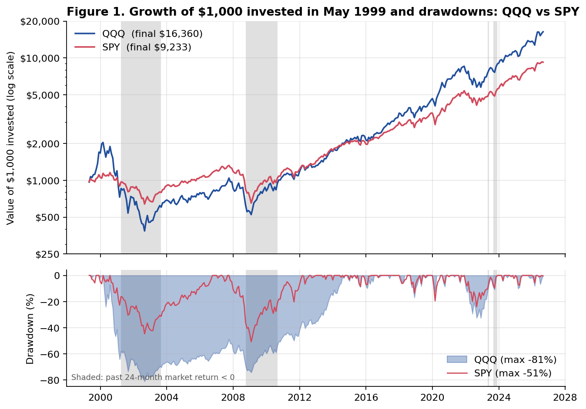
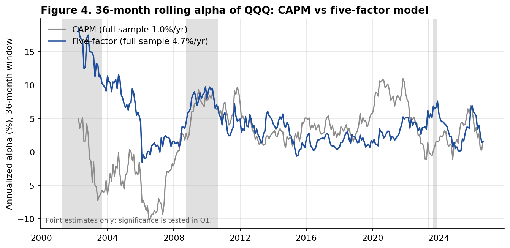

# Is the Nasdaq-100 Premium Alpha or Factor Risk?

Columbia University, Fall 2026.

QQQ (Nasdaq-100) returned about 1.8 times as much as SPY (S&P 500) from 1999 to 2026. We ask whether that premium is alpha or compensation for factor exposure. The tools are Fama-French factor regressions on 329 monthly observations (May 1999 to September 2026), with diagnostics, hypothesis tests, an out-of-sample split and a hedging backtest.

## Findings

| Question | Result |
|---|---|
| Is QQQ's return explained by the market alone (CAPM)? | Yes: CAPM alpha is 0.96% a year, p = 0.73 (Newey-West) |
| Do profitability (RMW) and investment (CMA) add information beyond FF3? | Yes: joint test F = 33.1, p < 0.001. QQQ loads negatively on HML (-0.47), RMW (-0.40) and CMA (-0.17) |
| What does the five-factor model leave unexplained? | Alpha of 4.7% a year, 95% CI [1.8%, 7.6%], p = 0.001. Once QQQ's anti-value, anti-profitability tilts are priced, its return looks too high rather than too low |
| Does market beta rise in crisis periods? | Yes: +0.08 per 1 SD of the crisis indicator (one-sided p = 0.014); beta goes from 1.14 in an average state to 1.30 at +2 SD |
| Out of sample (train 1999-2018, test 2018-2026) | FF5 has the lowest test error (MSPR 6.16 vs 7.61 for CAPM); momentum adds nothing |

Risk-adjusted, QQQ and SPY are nearly identical over the full sample (Sharpe 0.47 vs 0.48). QQQ's maximum drawdown was -81%, against -51% for SPY.




## Contents

| Path | Contents |
|---|---|
| `code/01_fetch_clean.py` | Download Ken French factors and Yahoo prices, clean, build the crisis indicator (falls back to the raw files offline) |
| `code/02_eda.py` | Descriptive tables and exploratory figures |
| `code/03_models.py` | CAPM, FF3, FF5, FF5 + momentum; nested F-tests, AIC / BIC |
| `code/04_diagnostics.py` | Residual checks, VIF, influence, Newey-West errors, orthogonalization, ridge trace |
| `code/05_tests.py` | The four research questions |
| `code/06_backtest.py` | 70/30 time split, rolling betas, hedging backtest, all-subsets comparison |
| `code/07_robustness.py` | Dropping influential months and 2000-02, Huber regression, alternative crisis definitions |
| `code/graphic.py` | Report figures |
| `qqq_dataset/` | Cleaned monthly dataset, raw inputs, cleaning script and QC report |
| `docs/` | Variable definitions, factor construction and figure notes (LaTeX and PDF) |
| `output/` | Figures and LaTeX tables |

```bash
pip install pandas numpy scipy statsmodels matplotlib yfinance
python code/01_fetch_clean.py
python code/03_models.py      # and so on, 02 to 07
```

Data: Kenneth R. French Data Library (factors, 10 industry portfolios) and Yahoo Finance (adjusted closes).
